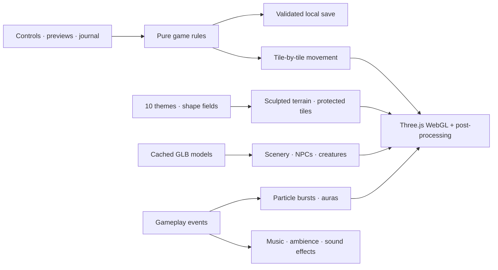

<div align="center">


# Wilder

### A path of mysteries

**Twelve adventurers. Ten worlds. One unforgettable journey.**

Roll the dice, follow a trail of weathered stones, and discover what waits beyond the next bend.<br>
A browser fantasy board game built with Three.js, original ambient audio, and living miniature worlds.

[](https://threejs.org/)
[](src)
[](#-quick-start)
[](#-ten-worlds-ten-shapes)
[](#-meet-your-adventurer)
[](#-how-to-play)

[Quick start](#-quick-start) · [World gallery](#-ten-worlds-ten-shapes) · [Characters](#-meet-your-adventurer) · [Audio & atmosphere](#-a-world-that-breathes) · [Architecture](#-under-the-island) · [Testing](#-tested-on-the-trail) · [Art status](#-art-status--credits)


<sub>Actual Three.js render. Every screenshot below comes from the playable world.</sub>

</div>

---

## 🧭 What is Wilder?

A little strategy. A little luck. A lot of curiosity.

Wilder brings a tabletop adventure into an interactive 3D diorama. Your character follows **93 connected tiles** from a welcoming village through four rising regions to a final destination. Along the way, hidden treasure, ancient portals, and strange encounters ask what kind of traveler you want to be.

- 🏝️ **Ten distinct landscapes:** different physical island shapes, terrain palettes, destinations, regional names, and encounter decks.
- 🎲 **A complete game:** fair six-sided dice, animated movement, branching encounters, gold, clues, local turns, and victory.
- 🧙 **Twelve adult adventurers:** next/previous selection, a rotating 3D preview, equipment and close-up views, action previews, and cosmetic aura colors.
- 🌿 **A path in the landscape:** low weathered stones, moss, plants, bridges, and visible changes in elevation.
- 🌙 **Twilight rendering:** cool moonlight, warm windows, flickering forge light, soft shadows, ambient occlusion, restrained bloom, and drifting mist.
- 🦋 **A living world:** rotating windmills, flowing rivers and waterfalls, swaying foliage, portal energy, fireflies, weather, and animated themed creatures.
- 🎧 **An original soundscape:** procedural ambient music, environmental textures, footsteps, discovery sounds, and separate volume controls.
- 💾 **Your journey stays with you:** validated local saves preserve progress, pending choices, party members, and appearance.
- 🗺️ **Preview before you travel:** actual map thumbnails and a live, orbitable 3D map preview, with previous/next navigation.

## 🚀 Quick start

```bash
git clone git@github.com:bogdancstrike/threejs-board-game.git
cd threejs-board-game
npm install
npm run dev
```

Open **[localhost:7777](http://localhost:7777)**.

Vite listens on `0.0.0.0:7777` with a strict port. Source changes appear through hot reload. No backend, database, API keys, or account are required.

| Requirement | What you need |
|---|---|
| Runtime | Node.js 22.12+; Node.js 24 LTS recommended |
| Browser | A current browser with WebGL 2 and Web Audio |
| Graphics | Hardware acceleration; choose Low in settings for lighter rendering |
| Network | Optional Google Fonts; models, previews, and game logic are served locally |

```bash
npm run build                    # Typecheck and create dist/
npm run preview -- --port 7778   # Inspect the production build
```

## 🗺️ Ten worlds. Ten shapes.

**These are screenshots of the real 3D maps**, refreshed from the same scene builders used by the game. Click any image to inspect it. Use **Worlds** in the game for a live preview before replacing your expedition.

<!-- WORLD_GALLERY_START -->

| 🌿 The Verdant Crown | 🐉 Dragonkind |
|---|---|
| [](public/previews/verdant.webp) | [](public/previews/dragonkind.webp) |
| An irregular woodland island. Lantern-lit homes, enchanted trees, and Crownfall Castle. | Jagged dragonwing crags. A Fourth Wing inspired rider academy, parapet, gauntlet, choosing, and signet mysteries. |
| ❄️ **The Frostbound Passage** | ☀️ **Sands of the Oracle** |
| [](public/previews/frost.webp) | [](public/previews/desert.webp) |
| A hexagonal ice floe. Snow, silver pines, crystal ice, and Winterglass Palace. | A diamond-shaped desert. Palms, turquoise water, obelisks, and a stepped sun temple. |
| 🌸 **Moonblossom Reach** | 🌋 **Emberfall Caldera** |
| [](public/previews/sakura.webp) | [](public/previews/ember.webp) |
| A five-petal island. Blossom groves, falling petals, a vermilion gate, and a mountain pagoda. | A volcanic ring. A molten caldera, obsidian cliffs, ember trees, and a circling phoenix. |
| 🌊 **The Tideglass Isles** | 🍄 **The Mycelium Hollow** |
| [](public/previews/tide.webp) | [](public/previews/mycelium.webp) |
| A floating archipelago. Linked islands, palms, waterfalls, a lighthouse, and a swimming sky whale. | A three-lobed hollow. Giant mushrooms, luminous plants, spores, and a fungal citadel. |
| ✨ **The Astral Observatory** | ⚙️ **The Clockwork Citadel** |
| [](public/previews/astral.webp) | [](public/previews/clockwork.webp) |
| A celestial crescent. Floating route stones, armillary spheres, violet stardust, and an observatory. | A toothed clockwork island. Copper gardens, canals, a turning gear, and a monumental clock tower. |

<!-- WORLD_GALLERY_END -->

Dragonkind is an original fan-inspired setting. It includes no copied novel text or named novel characters.

## 🎲 How to play

1. **Choose a world.** Inspect its terrain and four chapters in the map preview.
2. **Choose an adventurer.** Rotate the model, try the action buttons, pick an aura, and select.
3. **Roll the dice.** Walk or run through every intermediate tile, including elevation changes.
4. **Follow your curiosity.** Resolve the tile you land on, then continue the expedition.
5. **Reach the destination.** The first player to the final tile wins. An exact roll is unnecessary.

| Tile | What happens |
|---|---|
| ❔ Mystery | Make a choice. Discover clues, find gold, or take a shortcut. Some choices cost gold. |
| 💎 Treasure | Collect **3 gold**. |
| ✦ Fortune | Collect **2 gold and 1 clue**. |
| 🌀 Portal | Move **3 extra tiles**. |
| 🏰 Destination | Complete the journey and celebrate. |

Bonus movement ends without triggering a chain of tile effects. Gold and clues record discoveries; they do not gate the finish. All character cosmetics share the same rules.

Play solo or choose **2–4 local players** in settings. Each player takes a turn on this device and can choose a different character. **Journey** opens the progress, inventory, and journal drawer. Restarting or changing worlds requires confirmation before replacing the saved expedition.

## 🧙 Meet your adventurer

| Adventurer | Archetype | Adventurer | Archetype |
|---|---|---|---|
| Lyra | Violet Enchantress | Aurelia | Golden Valkyrie |
| Seraphine | Moonlight Knight | Selene | Frost Witch |
| Rhea | Scarlet Rogue | Vesper | Crimson Demoness |
| Elowen | Elven Priestess | Alaric | Royal Paladin |
| Akari | Kitsune Sorceress | Kael | Shadow Swordsman |
| Nyx | Shadow Assassin | Orion | Arcane Scholar |

All twelve fictional characters are adults. The selector provides **full body, upper body, close-up, and equipment views**, smooth camera transitions, orbit/zoom, previous/next buttons, and selection. Action previews include **Idle, Walk, Run, Relax, and Magic**. Characters breathe, gesture, rest while waiting, and react to discoveries; their visual animation stays separate from authoritative game state.

Eight entries currently use adapted GLB art from the supplied model collection. Four use clearly labeled prototype figurines. See [art status](#-art-status--credits) for the practical limits of the current art and animation.

## 🎧 A world that breathes

**Audio** is generated with Web Audio: slow harmonic pads, sparse melodic notes, stereo placement, convolution reverb, wind/water textures, and map-specific musical modes. Dragonkind and Emberfall use darker harmonies; the desert uses a different scale; frost and astral worlds have their own tonal centers.

Dice, UI, footsteps, landings, magic, treasure, portals, transitions, and victory have separate effect voices. Enable audio with the header speaker or in settings. **Music, World ambience, and Game effects** have independent volume sliders and saved preferences. Audio fades when the page is hidden. No prerecorded soundtrack or third-party music service is required.

**Visual effects** include GPU flow patterns on water and falls, portal energy, pulsing rune rings, crystal glows, lantern flicker, ground mist, clouds below the island, character auras, footsteps, landing dust, discovery bursts, and celebration particles. Weather changes with the world: petals, snow, embers, spores, or fireflies.

| Quality | Rendering |
|---|---|
| Low | Lighter effects and particles; post-processing and shadows bypassed |
| Medium | Soft shadows, reduced-resolution GTAO, restrained bloom, flowing water, atmosphere |
| Ultra | Higher-resolution shadows and AO, extra atmospheric particles, subtle light shafts |

Quality and movement-pace preferences persist across map changes and reloads. Performance targets require measurement on representative hardware; no unspecified-GPU 60 FPS guarantee is made.

## ⌨️ Make yourself at home

| Input | Action |
|---|---|
| Drag | Orbit the island or preview |
| Right-drag | Pan |
| Scroll / pinch | Zoom |
| `Space` | Roll the dice |
| `F` | Find the active character |
| `R` | Reset the camera |
| `Escape` | Close an ordinary dialog |

The board fills the viewport below the slim header. Details live in drawers and dialogs. Mystery encounters stay open until a choice is made.

## 🏗️ Under the island



| Source | Responsibility |
|---|---|
| [`src/game/`](src/game/) | Roster, deterministic route, ten themes, rules, turns, mysteries, victory, saves |
| [`shapes.ts`](src/world/shapes.ts) · [`terrain.ts`](src/world/terrain.ts) | Unique physical silhouettes, cutouts, islands, protected tile and landmark foundations, sculpted cliffs |
| [`world.ts`](src/world/world.ts) · [`landmarks.ts`](src/world/landmarks.ts) | Board integration, village, windmill, portal, rivers, bridges and themed destinations |
| [`environment.ts`](src/world/environment.ts) | Optimized imported plants, buildings, NPCs and animated creatures |
| [`assets.ts`](src/world/assets.ts) · [`rig.ts`](src/world/rig.ts) | Cached GLB loading, normalization, skeleton cloning and approximate static-model rigs |
| [`animation.ts`](src/world/animation.ts) · [`character-effects.ts`](src/world/character-effects.ts) | Independent character actions and role effects |
| [`lighting.ts`](src/world/lighting.ts) · [`ao.ts`](src/world/ao.ts) | Centralized twilight lighting, quality-aware AO and transparent-effect exclusions |
| [`water.ts`](src/world/water.ts) · [`atmosphere.ts`](src/world/atmosphere.ts) · [`vfx.ts`](src/world/vfx.ts) | GPU water, weather, mist, rune glows and pooled effects |
| [`scene.ts`](src/world/scene.ts) | Renderer, camera, quality presets, movement, previews and resource lifecycle |
| [`src/audio/`](src/audio/) | Procedural score, soundscapes, effects and saved volume controls |
| [`src/main.ts`](src/main.ts) · [`src/style.css`](src/style.css) | Responsive interface and interaction |

Static props are batched, tiles are instanced, symbols share an atlas, imported models are cached and lazily loaded, and Meshopt/WebP reduce asset transfer size. Rendering pauses behind dialogs and on hidden pages. The lighting pipeline uses linear calculations, ACES tone mapping, and sRGB output.

## 🧪 Tested on the trail

```bash
npm test                        # Pure rules, complete routes, world and preference validation
npm run test:e2e                 # Chromium/WebGL gameplay, previews, animation bounds and audio
npm run build                   # Strict TypeScript and production bundle
```

The browser suite exercises character selection and movement, save restoration, all ten themes, mobile layout, live map previews, animation bounds, and nonzero Web Audio output. It uses software WebGL in headless Chromium; install the browser with `npx playwright install chromium` if needed. Low-quality smoke checks and normal-quality visual renders serve different validation purposes.

## 🎨 Art status & credits

The game integrates models supplied from the local model collection, with original attribution and license metadata retained in **[asset credits](public/ASSET-CREDITS.md)** and the **[environment manifest](public/models/environment/manifest.json)**. The help dialog also links the credits. The source Downloads directory is not needed to run the game.

The roster uses **eight adapted character models and four explicit prototype figurines**. Imported art does not exactly match every written hair, outfit, or equipment specification. Existing skeletons use procedural posing; static models receive approximate deformation rigs. Final authored animation clips, facial animation, polished skin weights, and matching production art for all twelve heroes remain art-production work.

The included environmental assets are resized, simplified, merged where practical, and compressed. Do not assume the code and all third-party art have the same license. Original music and sound effects are synthesized by the application.

- [Character asset integration](docs/ASSETS.md)
- [Terrain design brief](map-terrain.md)
- [Character design brief](characters.md)
- [Lighting design brief](lighting.md)
- [Implementation coverage](docs/IMPLEMENTATION.md)

## 📸 Keeping the gallery current

With the development server running:

```bash
npm run screenshots
```

This renders **every real map** through its current Three.js scene, publishes the thumbnails used by the app and README, and regenerates the contact sheet. Refresh this gallery whenever terrain, silhouettes, lighting, assets, or composition changes. Feature claims, limitations, controls, and validation instructions in this README should be updated in the same commit as the implementation.

<div align="center">


<sub>A little courage. A little magic.</sub>

</div>
