<div align="center">

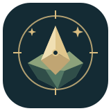

# Wilder

### A path of mysteries

**Twelve adventurers. Thirty worlds. One unforgettable journey.**

Roll the dice, follow a trail of weathered stones, and discover what waits beyond the next bend.<br>
A browser fantasy board game built with Three.js, original ambient audio, and living miniature worlds.

[](https://threejs.org/)
[](src)
[](#-quick-start)
[](backend/)
[](compose.yaml)
[](#-thirty-worlds-thirty-shapes)
[](#-meet-your-adventurer)
[](#-how-to-play)

[Quick start](#-quick-start) · [World gallery](#-thirty-worlds-thirty-shapes) · [Characters](#-meet-your-adventurer) · [Audio & atmosphere](#-a-world-that-breathes) · [Architecture](#-under-the-island) · [Testing](#-tested-on-the-trail) · [Art status](#-art-status--credits)

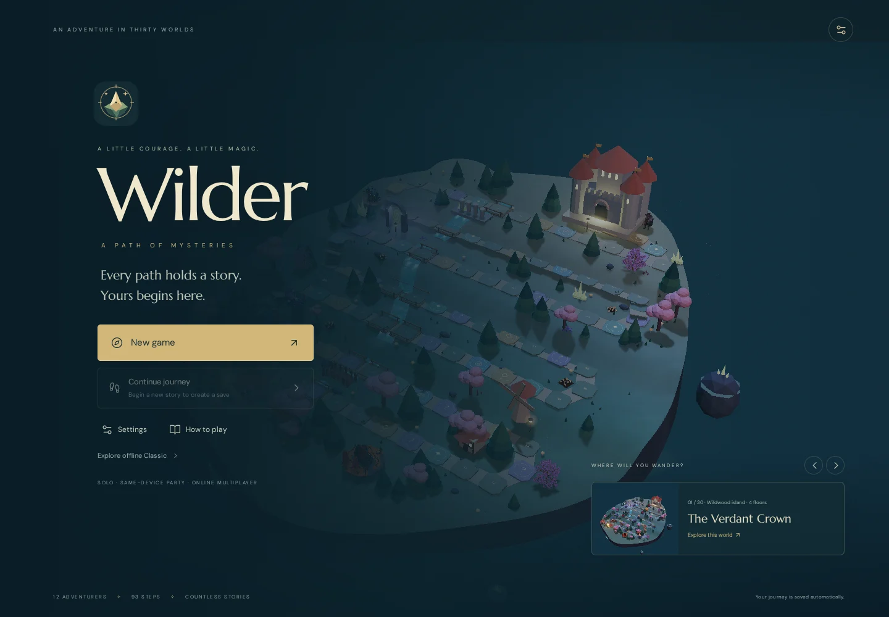

<sub>Actual Three.js render. Every screenshot below comes from the playable world.</sub>

</div>

---

## 🧭 What is Wilder?

A little strategy. A little luck. A lot of curiosity.

Wilder brings a tabletop adventure into an interactive 3D diorama. Your character follows **93 connected tiles** from a welcoming village through four chapters across three to nine floors to a final destination. Along the way, hidden treasure, ancient portals, and strange encounters ask what kind of traveler you want to be.

- 🧭 **A real start menu:** New game, Continue, settings, how to play, and a carousel of thirty world previews over a living 3D island.
- 🏝️ **Thirty distinct landscapes:** different physical island shapes, terrain palettes, destinations, regional names, and encounter decks.
- 🎲 **A complete game:** fair six-sided dice, animated movement, branching encounters, gold, clues, points, local turns, live online rooms, and victory.
- 🧙 **Twelve adult adventurers:** next/previous selection, a rotating 3D preview, equipment and close-up views, action previews, and cosmetic aura colors.
- 🌿 **A path in the landscape:** low weathered stones, moss, plants, bridges, and visible changes in elevation.
- 🌙 **Twilight rendering:** cool moonlight, warm windows, flickering forge light, soft shadows, ambient occlusion, restrained bloom, and drifting mist.
- 🦋 **A living world:** rotating windmills, flowing rivers and waterfalls, swaying foliage, portal energy, fireflies, weather, and animated themed creatures.
- 🎧 **An original soundscape:** procedural ambient music, environmental textures, footsteps, discovery sounds, and separate volume controls.
- 💾 **Your journey stays with you:** validated local saves preserve progress, pending choices, party members, and appearance.
- 🗺️ **Preview before you travel:** actual map thumbnails and a live, orbitable 3D map preview, with previous/next navigation.

## 🚀 Quick start

```bash
git clone git@github.com:bogdancstrike/threejs-board-game.git
cd threejs-board-game
npm install
npm run dev
```

Open **[localhost:7777](http://localhost:7777)**.

Vite listens on `0.0.0.0:7777` with a strict port. Source changes appear through hot reload. This starts the browser game and local pass-and-play. Online rooms use the FastAPI/PostgreSQL service below. No external account or API keys are required.

| Requirement | What you need |
|---|---|
| Runtime | Node.js 22.12+; Node.js 24 LTS recommended |
| Browser | A current browser with WebGL 2 and Web Audio |
| Graphics | Hardware acceleration; choose Low in settings for lighter rendering |
| Network | Optional Google Fonts; models, previews, and game logic are served locally |

```bash
# Full game: persistent rooms + realtime multiplayer
python3 scripts/init-env.py      # Generate ignored local database credentials
docker compose up -d --build    # Web :7777, FastAPI :8000, PostgreSQL :55432
# Stop npm run dev first if port 7777 is already occupied.

npm run build                    # Typecheck and create dist/
npm run preview -- --port 7778   # Inspect the production build
```

For backend development, run `docker compose up -d db`, then `uv sync --directory backend` and `uv run --directory backend uvicorn app.main:app --host 0.0.0.0 --port 8000 --reload` alongside `npm run dev`. Vite proxies HTTP and WebSocket traffic under `/api`. The generated `.env` must stay private. PostgreSQL data lives in a named Docker volume.

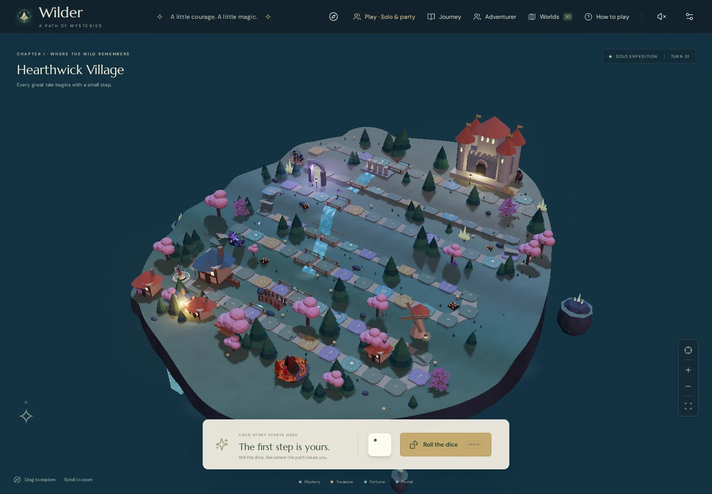

## 👥 Bring your party

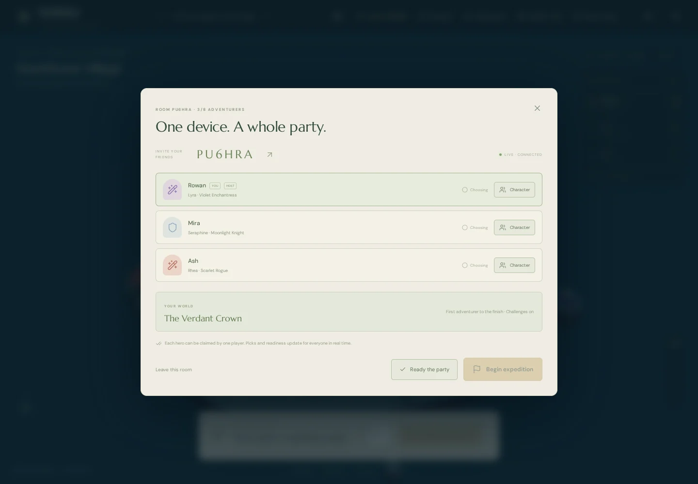

Choose **New game** on the title screen (or **Play · Solo & party** on the board), enter player names, and choose **On this device** for solo/pass-and-play or **Online** to create/join a six-character room code. Same-device Adventure supports **1–8 named players**, unique heroes, and a “pass the device” dialog between turns. Both Adventure play styles use the running game server. **1–8 online players** each claim a unique hero, mark ready, and let the host begin. Character claims are enforced by a PostgreSQL constraint and transactional server rules. Every browser sees the same die roll, movement, active player, journal, and points.

Classic races end at the finish. Score expeditions finish the current round, then rank players by points. The server awards progress, treasure, clues, challenge rewards, and a finish bonus. **Ten mini-games** include riddles, counting, memory, patterns, balance, rhythm, arithmetic, spotting a mimic, a navigable maze, and alchemy. Rematches return the party to the lobby.

Room progress persists in PostgreSQL. Browser sessions reconnect to an authoritative snapshot; commands use revision checks and idempotency keys to prevent duplicate rolls. Turns and encounters have server deadlines. Room sessions last 12 hours. **Local 1–4 player pass-and-play remains available without the backend.**

## 🗺️ Thirty worlds. Thirty shapes.

**These are screenshots of the real 3D maps**, refreshed from the same scene builders used by the game. Click any image to inspect it. Use **Worlds** in the game for a live preview before replacing your expedition.

<!-- WORLD_GALLERY_START -->

| **The Verdant Crown** | **Dragonkind** |
|---|---|
| [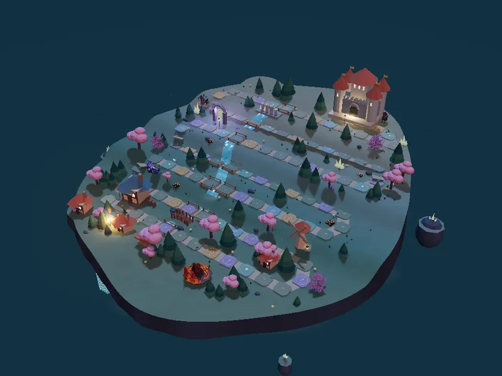](public/previews/verdant.webp) | [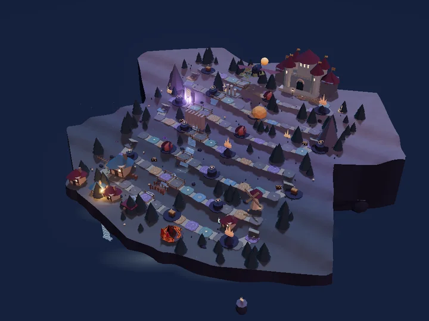](public/previews/dragonkind.webp) |
| Wildwood island · 4 floors<br>Where the wild remembers | Dragonwing crags · 7 floors<br>Brave the parapet. Earn your wings. |

| **The Frostbound Passage** | **Sands of the Oracle** |
|---|---|
| [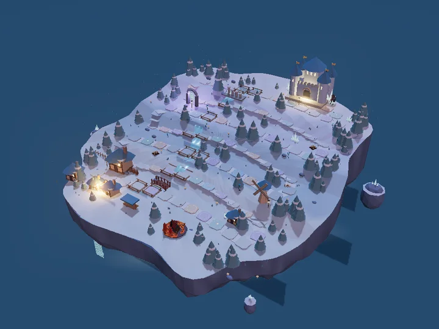](public/previews/frost.webp) | [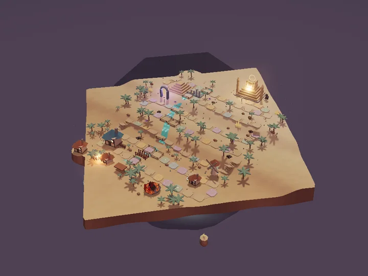](public/previews/desert.webp) |
| Hexagonal ice floe · 5 floors<br>A secret beneath the snow | Diamond of the dunes · 3 floors<br>Every grain holds a story |

| **Moonblossom Reach** | **Emberfall Caldera** |
|---|---|
| [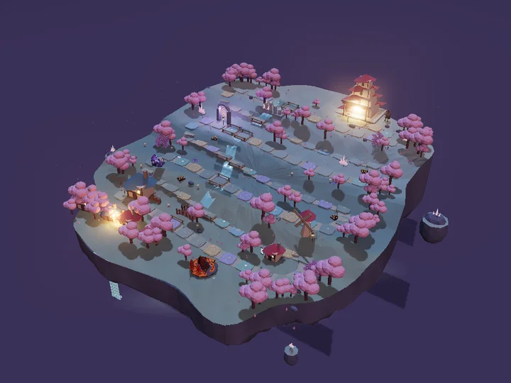](public/previews/sakura.webp) | [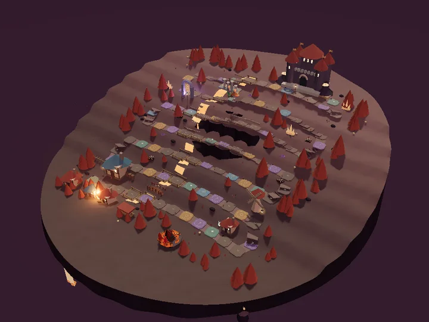](public/previews/ember.webp) |
| Five-petal blossom · 6 floors<br>Follow the falling petals | Volcanic caldera · 8 floors<br>A journey forged in fire |

| **The Tideglass Isles** | **The Mycelium Hollow** |
|---|---|
| [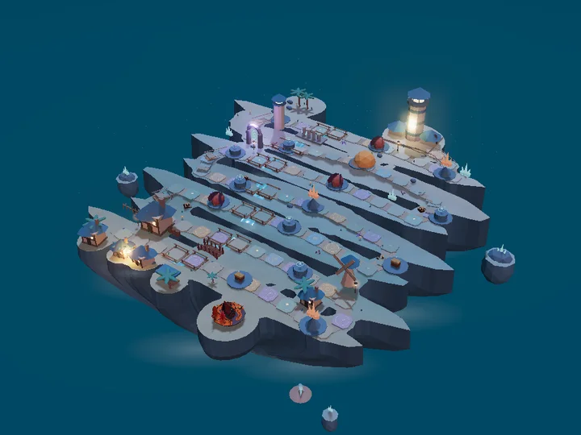](public/previews/tide.webp) | [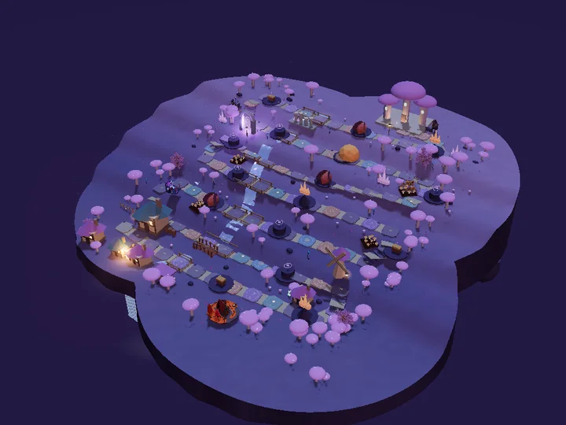](public/previews/mycelium.webp) |
| Floating archipelago · 4 floors<br>Beyond the last horizon | Three-lobed hollow · 5 floors<br>A world beneath the world |

| **The Astral Observatory** | **The Clockwork Citadel** |
|---|---|
| [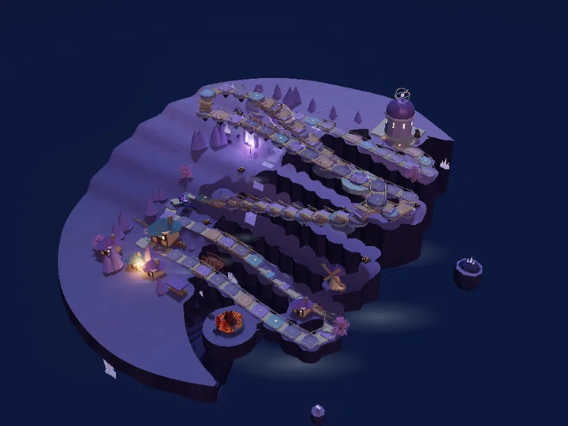](public/previews/astral.webp) | [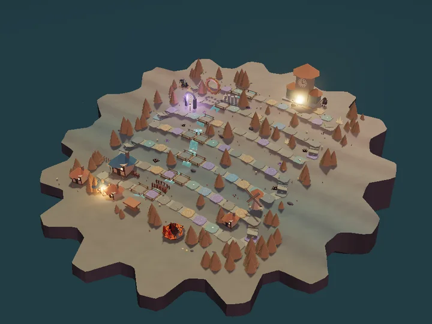](public/previews/clockwork.webp) |
| Celestial crescent · 6 floors<br>Walk between the stars | Clockwork cog · 7 floors<br>An adventure out of time |

| **Stormreach Bastion** | **The Amberwood Harvest** |
|---|---|
| [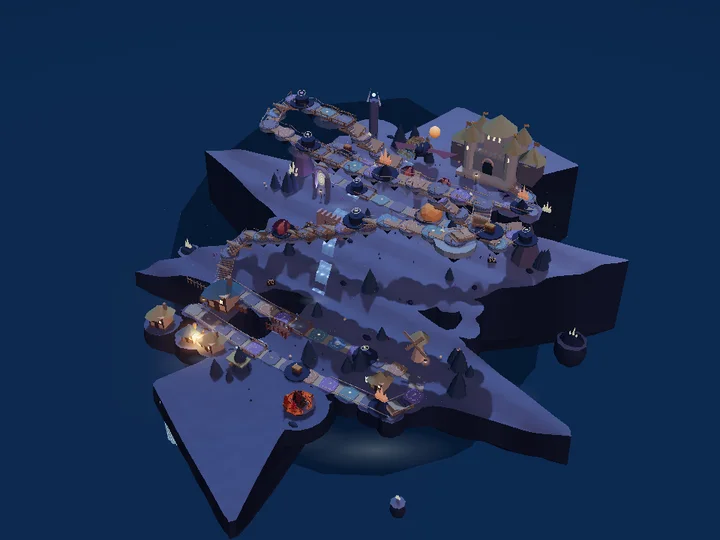](public/previews/stormreach.webp) | [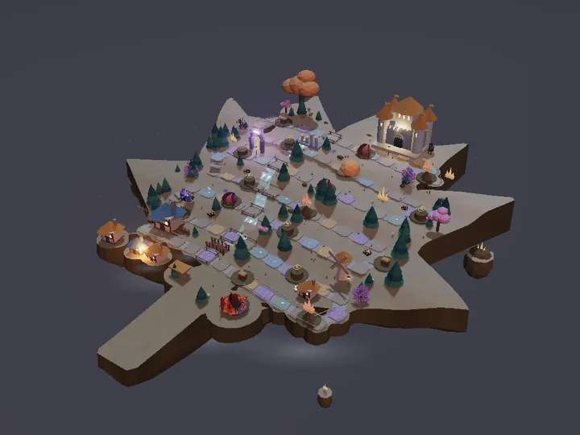](public/previews/autumn.webp) |
| Forked lightning ridge · 9 floors<br>Climb where the thunder sleeps | Falling maple leaf · 4 floors<br>Every falling leaf is a promise |

| **The Jade Lotus** | **The Pale Necropolis** |
|---|---|
| [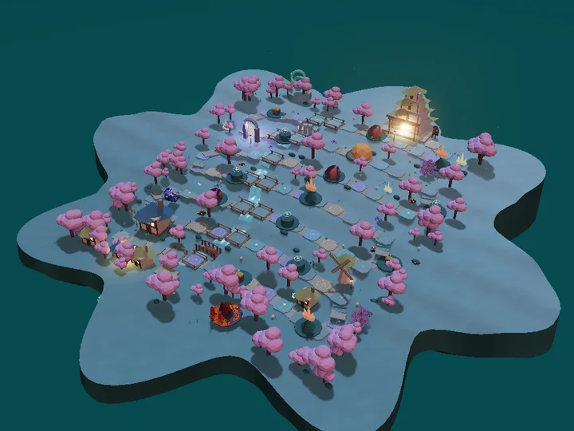](public/previews/jade.webp) | [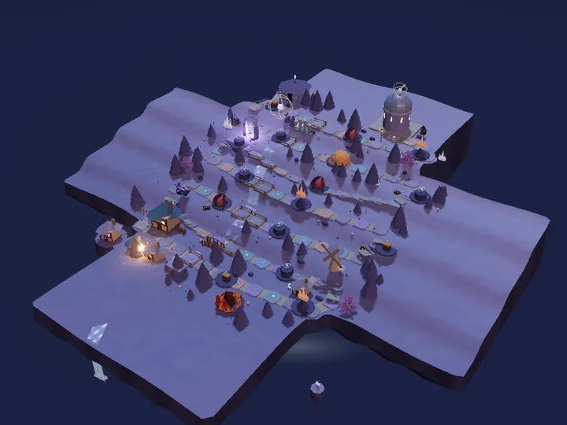](public/previews/necropolis.webp) |
| Eight-petal lotus · 7 floors<br>Find the stillness at the center | Ancient stone cross · 5 floors<br>Some stories refuse to rest |

| **Cloudwake Skyharbor** | **The Coral Spiral** |
|---|---|
| [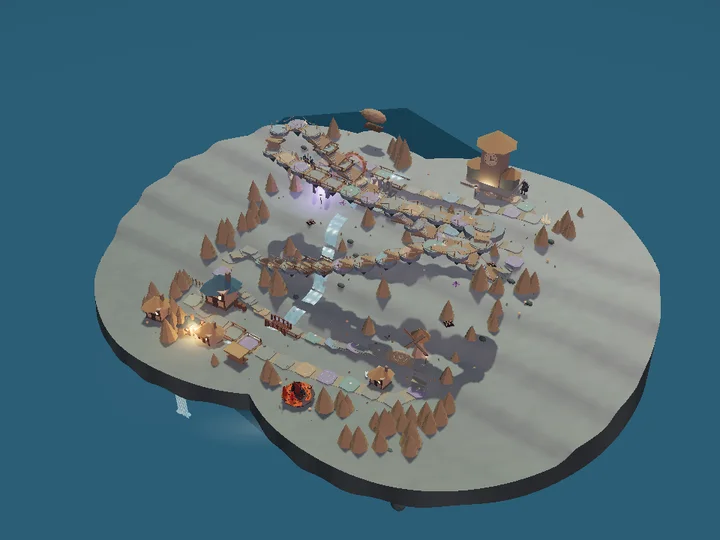](public/previews/skyharbor.webp) | [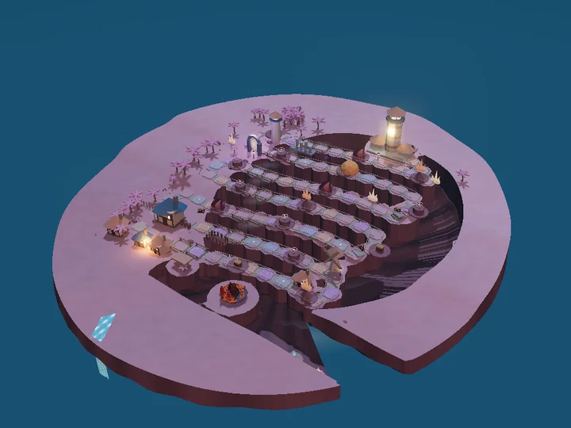](public/previews/coral.webp) |
| Twin cloud banks · 6 floors<br>The sky is only the beginning | Coral spiral · 3 floors<br>Follow the tide inward |

| **The Honeyglass Expanse** | **The Obsidian Forge** |
|---|---|
| [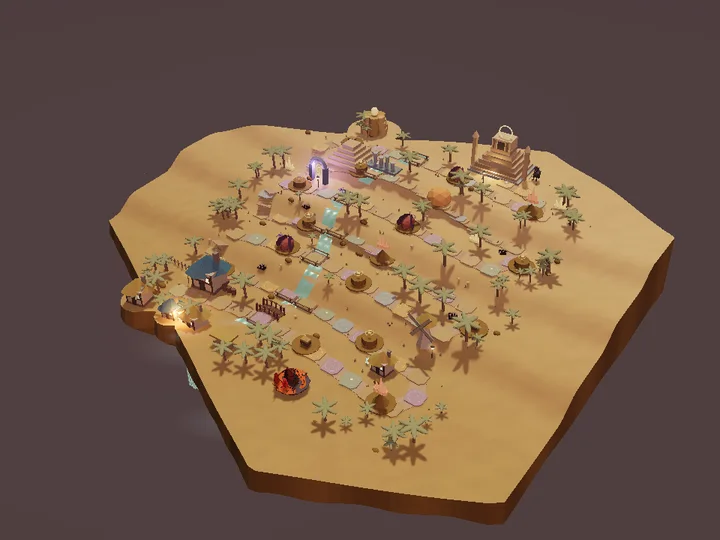](public/previews/amber.webp) | [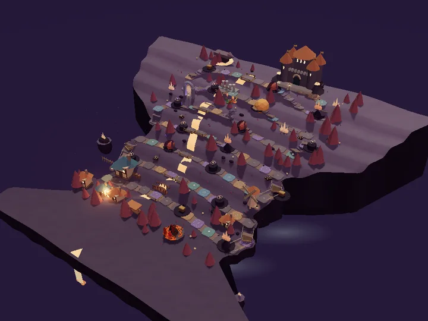](public/previews/obsidian.webp) |
| Golden honeycomb · 4 floors<br>A kingdom built one golden cell at a time | The mountain anvil · 8 floors<br>Let the mountain shape your legend |

| **The Prism Sanctuary** | **The Serpent Canopy** |
|---|---|
| [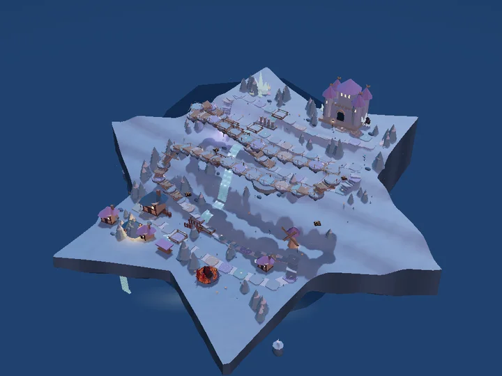](public/previews/crystal.webp) | [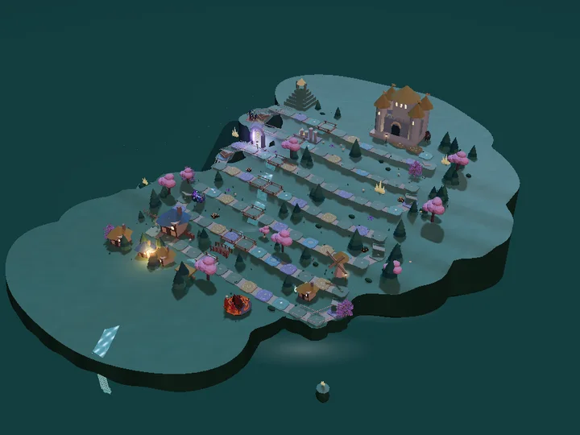](public/previews/jungle.webp) |
| Six-point crystal star · 6 floors<br>Every color remembers the light | Serpent’s spine · 7 floors<br>The oldest paths are still alive |

| **The Roseheart Court** | **The Twin Moon Enclave** |
|---|---|
| [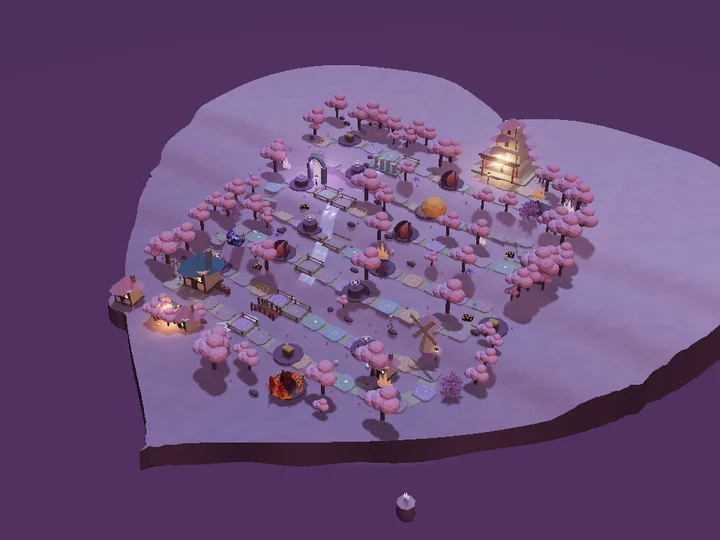](public/previews/rose.webp) | [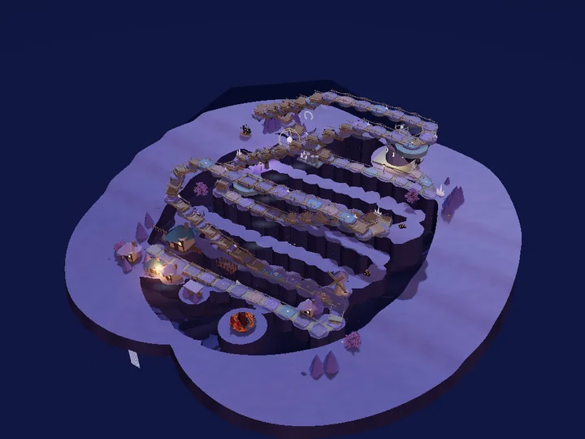](public/previews/lunar.webp) |
| Heart of the garden · 4 floors<br>Courage is a kind of kindness | Twin lunar crescents · 5 floors<br>Two moons. One forgotten promise. |

| **The Brass Hourglass** | **The Manta Lagoon** |
|---|---|
| [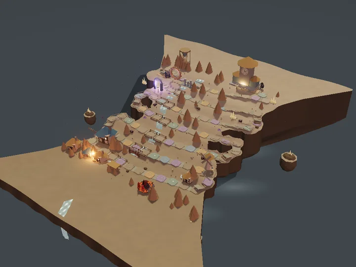](public/previews/brass.webp) | [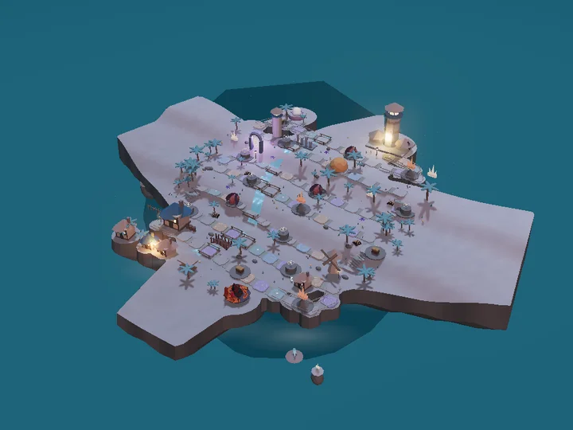](public/previews/pearl.webp) |
| Sands of the hourglass · 8 floors<br>Borrow a moment from forever | Manta-ray lagoon · 3 floors<br>Sail on the wings of the tide |

| **The Verdigris Engine** | **Snowspire Ascent** |
|---|---|
| [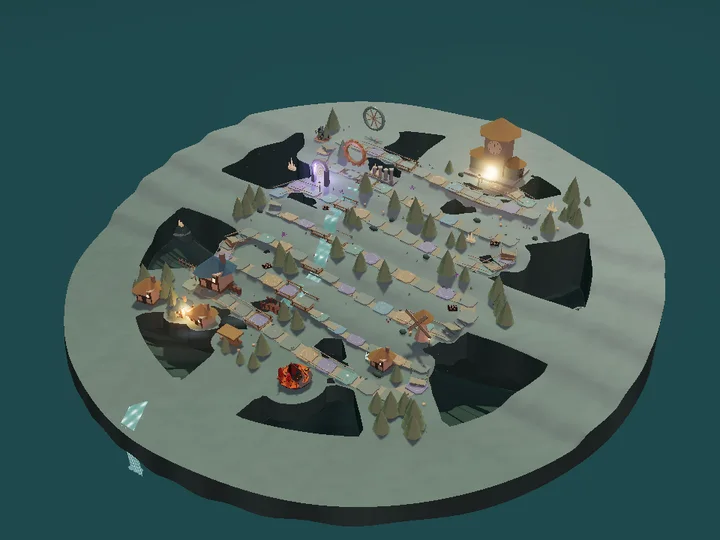](public/previews/verdigris.webp) | [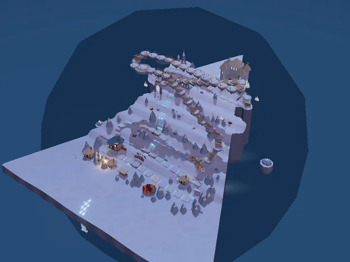](public/previews/snowspire.webp) |
| Eight-spoke wheel · 6 floors<br>Find the heart inside the machine | Triangular mountain · 9 floors<br>The summit is a promise you keep |

| **The Sunken Atoll** | **The Dreamer’s Labyrinth** |
|---|---|
| [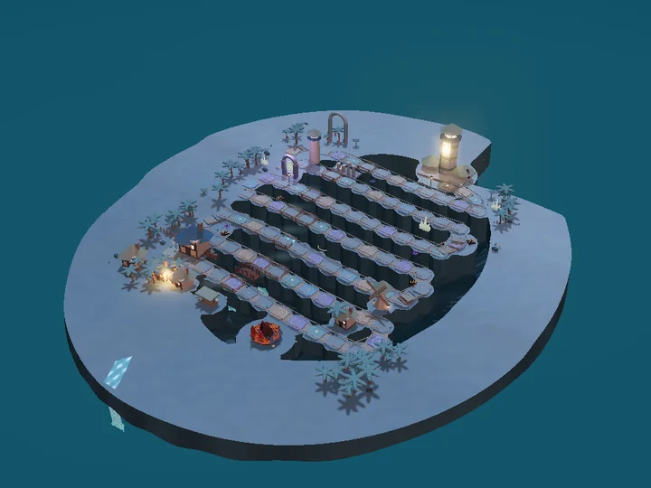](public/previews/sunken.webp) | [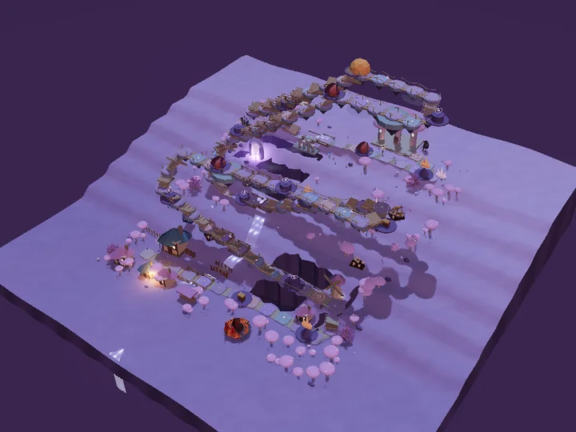](public/previews/dream.webp) |
| Broken atoll · 3 floors<br>What the sea keeps, the tide reveals | Dreamer’s labyrinth · 7 floors<br>Turn a corner. Change the dream. |

| **The Lantern Night Market** | **The Aurora Ribbon** |
|---|---|
| [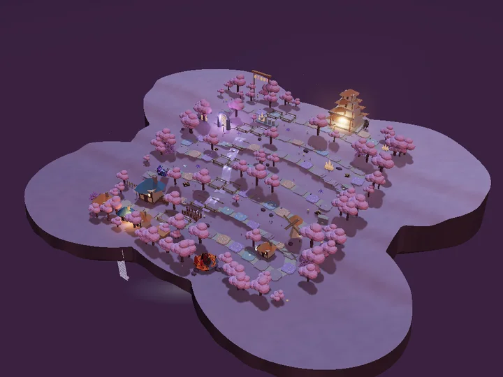](public/previews/nightmarket.webp) | [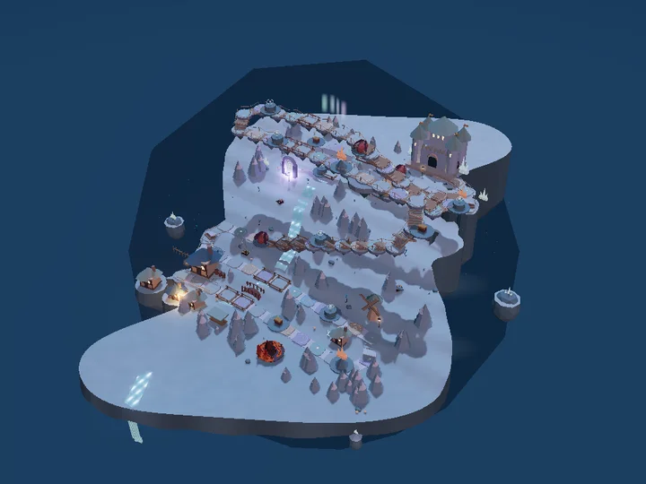](public/previews/aurora.webp) |
| Four-lantern pavilion · 5 floors<br>A thousand lights. A thousand stories. | Aurora ribbon · 8 floors<br>Walk where the northern lights fall |

<!-- WORLD_GALLERY_END -->

Dragonkind is an original fan-inspired setting. It includes no copied novel text or named novel characters.

## 🎲 How to play

1. **Choose a world.** Inspect its terrain and four chapters in the map preview.
2. **Choose an adventurer.** Rotate the model, try the action buttons, pick an aura, and select.
3. **Roll the dice.** Walk or run through every intermediate tile, including elevation changes.
4. **Follow your curiosity.** Resolve the tile you land on, then continue the expedition.
5. **Reach the destination.** The first player to the final tile wins. An exact roll is unnecessary.

| Tile | What happens |
|---|---|
| ❔ Mystery | Make a choice. Discover clues, find gold, or take a shortcut. Some choices cost gold. |
| 💎 Treasure | Collect **3 gold**. |
| ✦ Fortune | Collect **2 gold and 1 clue**. |
| 🌀 Portal | Move **3 extra tiles**. |
| 🏰 Destination | Complete the journey and celebrate. |

Bonus movement ends without triggering a chain of tile effects. Gold and clues record discoveries and can pay for safe passage at Adventure encounters; they do not gate the finish. All character cosmetics share the same rules.

Play solo or choose **2–4 local players** in settings. Each player takes a turn on this device and can choose a different character. **Journey** opens the progress, inventory, and journal drawer. Restarting or changing worlds requires confirmation before replacing the saved expedition.

## 🐉 The road has other plans

Seventeen marked stops turn each map into an adventure: **dragon guardians**, **mystery boxes**, **mini-game pavilions**, **creative dares**, **dangerous crossings**, **warding shrines**, **hexes**, and **rest camps**. Guardians stand beside their protected tiles; boxes and shrines have animated roadside props. Hover a marked tile for its encounter.

Face a dragon's trial for **75 points, 4 gold and a shortcut**, offer tribute, or retreat safely. Boxes can contain treasure, a mimic, or a mini-game. Wards absorb danger; camps clear hexes. A failed risky trial can cost gold or points, push you back, or slow your next move. **Every risk is stated before accepting it**, and currencies stay at zero or above. Creative dares are optional and self-reported, with puzzle and pass alternatives.

Read the [full encounter and multiplayer specification](docs/specifications/ROAD_ADVENTURES.md) for rewards, deadlines, probabilities and protections. Choose Story only at creation to keep the original road rules.

## 🧙 Meet your adventurer

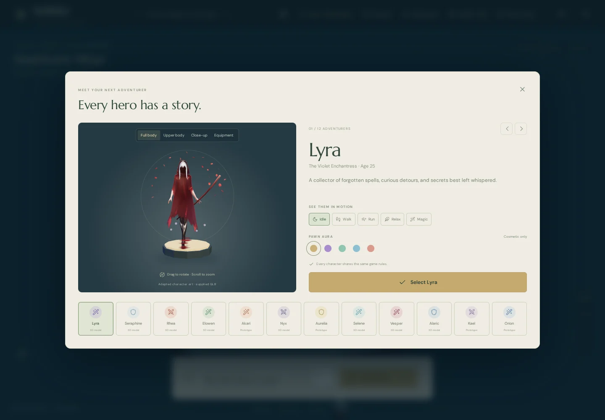

| Adventurer | Archetype | Adventurer | Archetype |
|---|---|---|---|
| Lyra | Violet Enchantress | Aurelia | Golden Valkyrie |
| Seraphine | Moonlight Knight | Selene | Frost Witch |
| Rhea | Scarlet Rogue | Vesper | Crimson Demoness |
| Elowen | Elven Priestess | Alaric | Royal Paladin |
| Akari | Kitsune Sorceress | Kael | Shadow Swordsman |
| Nyx | Shadow Assassin | Orion | Arcane Scholar |

All twelve fictional characters are adults. The selector provides **full body, upper body, close-up, and equipment views**, smooth camera transitions, orbit/zoom, previous/next buttons, and selection. Action previews include **Idle, Walk, Run, Relax, and Magic**. Characters breathe, gesture, rest while waiting, and react to discoveries; their visual animation stays separate from authoritative game state.

Eight entries currently use adapted GLB art from the supplied model collection. Four use clearly labeled prototype figurines. See [art status](#-art-status--credits) for the practical limits of the current art and animation.

## 🎧 A world that breathes

**Audio** is generated with Web Audio: slow harmonic pads, sparse melodic notes, stereo placement, convolution reverb, wind/water textures, and map-specific musical modes. Dragonkind and Emberfall use darker harmonies; the desert uses a different scale; frost and astral worlds have their own tonal centers.

Dice, UI, footsteps, landings, magic, treasure, portals, transitions, and victory have separate effect voices. Enable audio with the header speaker or in settings. **Music, World ambience, and Game effects** have independent volume sliders and saved preferences. Audio fades when the page is hidden. No prerecorded soundtrack or third-party music service is required.

**Visual effects** include GPU flow patterns on water and falls, portal energy, pulsing rune rings, crystal glows, lantern flicker, ground mist, clouds below the island, character auras, footsteps, landing dust, discovery bursts, and celebration particles. Weather changes with the world: petals, snow, embers, spores, or fireflies.

| Quality | Rendering |
|---|---|
| Low | Lighter effects and particles; post-processing and shadows bypassed |
| Medium | Soft shadows, reduced-resolution GTAO, restrained bloom, flowing water, atmosphere |
| Ultra | Higher-resolution shadows and AO, extra atmospheric particles, subtle light shafts |

Quality and movement-pace preferences persist across map changes and reloads. Performance targets require measurement on representative hardware; no unspecified-GPU 60 FPS guarantee is made.

## ⌨️ Make yourself at home

| Input | Action |
|---|---|
| Drag | Orbit the island or preview |
| Right-drag | Pan |
| Scroll / pinch | Zoom |
| `Space` | Roll the dice |
| `F` | Find the active character |
| `R` | Reset the camera |
| `Escape` | Close an ordinary dialog |

The board fills the viewport below the slim header. Details live in drawers and dialogs. Mystery encounters stay open until a choice is made.

## 🏗️ Under the island

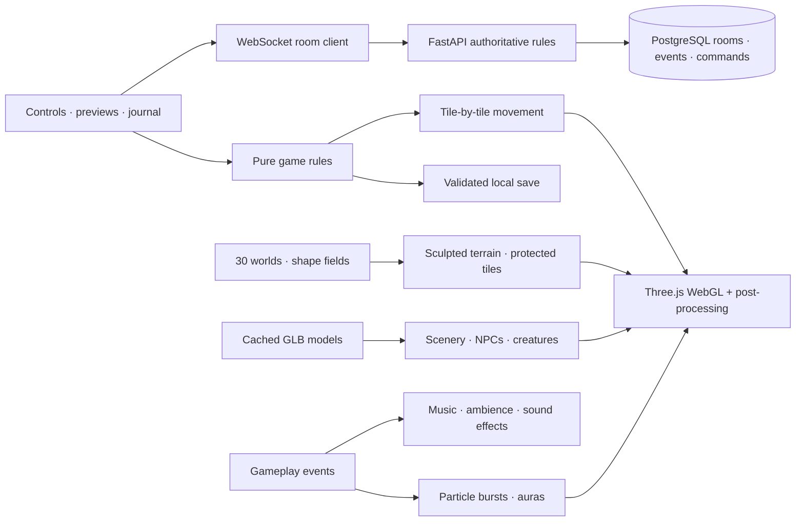

| Source | Responsibility |
|---|---|
| [`backend/`](backend/) | FastAPI, PostgreSQL transactions, room sessions, authoritative turns, points, challenges and WebSocket broadcasts |
| [`src/network/`](src/network/) | Room lobby, reconnecting client, unique hero claims and mini-game panels |
| [`src/game/`](src/game/) | Roster, deterministic route, thirty themes, rules, turns, mysteries, victory, saves |
| [`shapes.ts`](src/world/shapes.ts) · [`terrain.ts`](src/world/terrain.ts) | Unique physical silhouettes, cutouts, islands, protected tile and landmark foundations, sculpted cliffs |
| [`world.ts`](src/world/world.ts) · [`landmarks.ts`](src/world/landmarks.ts) | Board integration, village, windmill, portal, rivers, bridges and themed destinations |
| [`environment.ts`](src/world/environment.ts) | Optimized imported plants, buildings, NPCs and animated creatures |
| [`assets.ts`](src/world/assets.ts) · [`rig.ts`](src/world/rig.ts) | Cached GLB loading, normalization, skeleton cloning and approximate static-model rigs |
| [`animation.ts`](src/world/animation.ts) · [`character-effects.ts`](src/world/character-effects.ts) | Independent character actions and role effects |
| [`lighting.ts`](src/world/lighting.ts) · [`ao.ts`](src/world/ao.ts) | Centralized twilight lighting, quality-aware AO and transparent-effect exclusions |
| [`water.ts`](src/world/water.ts) · [`atmosphere.ts`](src/world/atmosphere.ts) · [`vfx.ts`](src/world/vfx.ts) | GPU water, weather, mist, rune glows and pooled effects |
| [`scene.ts`](src/world/scene.ts) | Renderer, camera, quality presets, movement, previews and resource lifecycle |
| [`src/audio/`](src/audio/) | Procedural score, soundscapes, effects and saved volume controls |
| [`src/main.ts`](src/main.ts) · [`src/style.css`](src/style.css) | Responsive interface and interaction |

Static props are batched, tiles are instanced, symbols share an atlas, imported models are cached and lazily loaded, and Meshopt/WebP reduce asset transfer size. Rendering pauses behind dialogs and on hidden pages. The lighting pipeline uses linear calculations, ACES tone mapping, and sRGB output.

## 🧪 Tested on the trail

```bash
uv run --directory backend pytest # Domain and real PostgreSQL integration tests
uv run --directory backend ruff check app tests
npm test                        # Pure rules, complete routes, world and preference validation
npm run test:e2e                 # Chromium/WebGL gameplay, previews, animation bounds and audio
npm run build                   # Strict TypeScript and production bundle
node scripts/map-metrics.mjs     # Route bounds, elevations and every map transition
```

The browser suite checks two independent multiplayer browsers, same-device names/hero picks/turn handoff, and exercises character selection and movement, save restoration, all thirty themes, mobile layout, live map previews, animation bounds, and nonzero Web Audio output. It uses software WebGL in headless Chromium; install the browser with `npx playwright install chromium` if needed. Low-quality smoke checks and normal-quality visual renders serve different validation purposes. [Recorded route metrics](reports/map_metrics.json) cover all 30 maps; these describe geometry and do not claim GPU performance.

## 🎨 Art status & credits

The game integrates models supplied from the local model collection, with original attribution and license metadata retained in **[asset credits](public/ASSET-CREDITS.md)** and the **[environment manifest](public/models/environment/manifest.json)**. The help dialog also links the credits. The source Downloads directory is not needed to run the game.

The roster uses **eight adapted character models and four explicit prototype figurines**. Imported art does not exactly match every written hair, outfit, or equipment specification. Existing skeletons use procedural posing; static models receive approximate deformation rigs. Final authored animation clips, facial animation, polished skin weights, and matching production art for all twelve heroes remain art-production work.

The included environmental assets are resized, simplified, merged where practical, and compressed. Do not assume the code and all third-party art have the same license. Original music and sound effects are synthesized by the application.

- [Asset attribution](public/ASSET-CREDITS.md)
- [Terrain design brief](map-terrain.md)
- [Character design brief](characters.md)
- [Lighting design brief](lighting.md)
- [Current runtime and deployment](docs/runtime/README.md)

## 📸 Keeping the gallery current

With the development server running:

```bash
npm run screenshots
```

This renders **every real map** through its current Three.js scene, publishes the thumbnails used by the app and README, and regenerates the contact sheet. Refresh this gallery whenever terrain, silhouettes, lighting, assets, or composition changes. Feature claims, limitations, controls, and validation instructions in this README should be updated in the same commit as the implementation.

<div align="center">


<sub>A little courage. A little magic.</sub>

</div>
