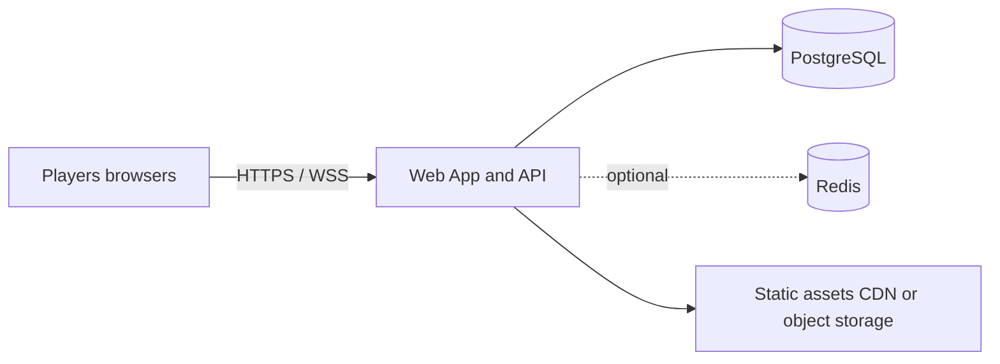
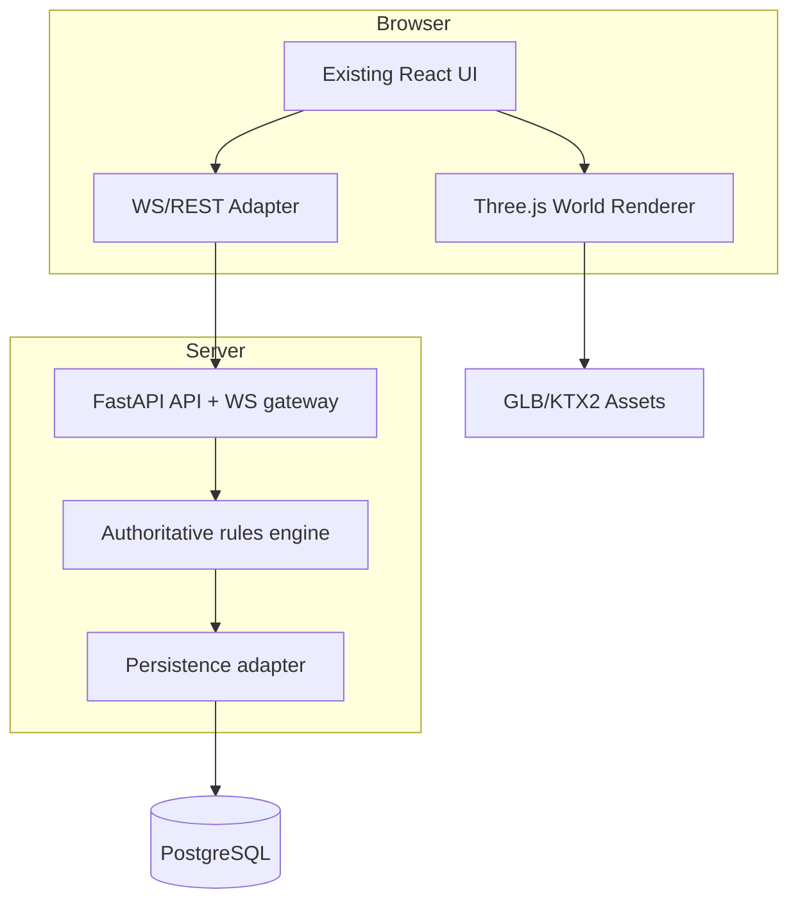
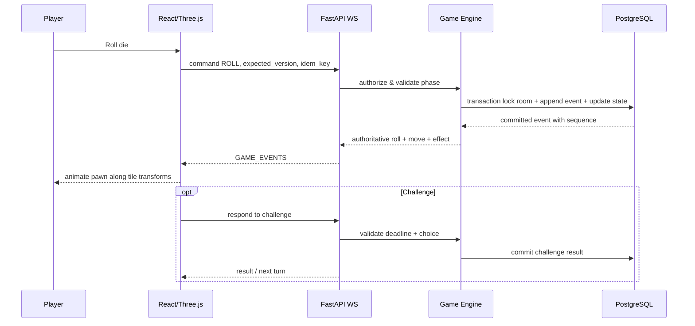

# Technical architecture — web-based authoritative game
## Recommended pragmatic stack
Frontend: React + TypeScript + Vite + existing UI (preserve existing design); Three.js with React Three Fiber ONLY if the repo already uses it or migration justified; Zustand for ephemeral client/view state; TanStack Query for REST; WebSocket client for game events; zod for DTO validation.
Backend: Python FastAPI + asyncio + Pydantic v2; WebSockets for events; REST for lobby/catalogue; PostgreSQL for persistent rooms/events/config; Redis **optional** for ephemeral presence/pubsub/scaled sockets. Do not introduce Kafka/microservices for an early-stage 2–8 player board game.
Auth: guest signed session tokens MVP; optional Keycloak OIDC later. Room access separate from account identity. CORS allowlist, origin checks on WS, short-lived tokens, room-scoped authorization.
Deployment: Docker Compose dev + VPS/container service; HTTPS/WSS via Caddy/NGINX; PostgreSQL managed or persistent volume. One backend instance initially, scale only when telemetry justifies it.

## C4 context (Mermaid)

## C4 containers

## Turn sequence

## Authoritative event model
Rooms have `version` and monotonically incrementing `event_seq`. Commands carry `room_id`, `actor_id`, `expected_version`, `idempotency_key`, and type-specific validated payload. In a DB transaction lock room row, check membership/turn/version, produce events, append, update snapshot/version and idempotency table. Deliver after commit; reconnect fetches events since `last_seen_seq` and snapshot if needed.

## Bounded real-time model
Small rooms only: WS fanout can be in-process in one instance; use Redis pub/sub if multi-instance. Never store authoritative match state only in browser or Redis. Event log/replay consistency backed by Postgres transactions.

## Tile visual contract
Core `Tile {id, type, effect}` independent of `TileWorldTransform {id, position:[x,y,z], quaternion, elevation, region}`. Do not alter rules as camera/visual designers move meshes. Movement visualization follows per-tile waypoints; server sends tile IDs, not arbitrary client transforms.

## State ownership
- Server: turn, die RNG, tile, score, action permissions, deadlines, room rules.
- Client: camera orbit, particles, UI modal state, render quality, local animation interpolation.
- Persist: participants, room, ruleset version, events, snapshots, selected character/cosmetics.

## Observability
Structured logs with room ID hashed/pseudonymous, command ID, seq and duration; Prometheus metrics active WS connections, command latency, mismatch/retry counts, active rooms, client FPS telemetry opt-in; OTel trace sample only on slow/error workflows. Never log challenge response text that may reveal personal data.
